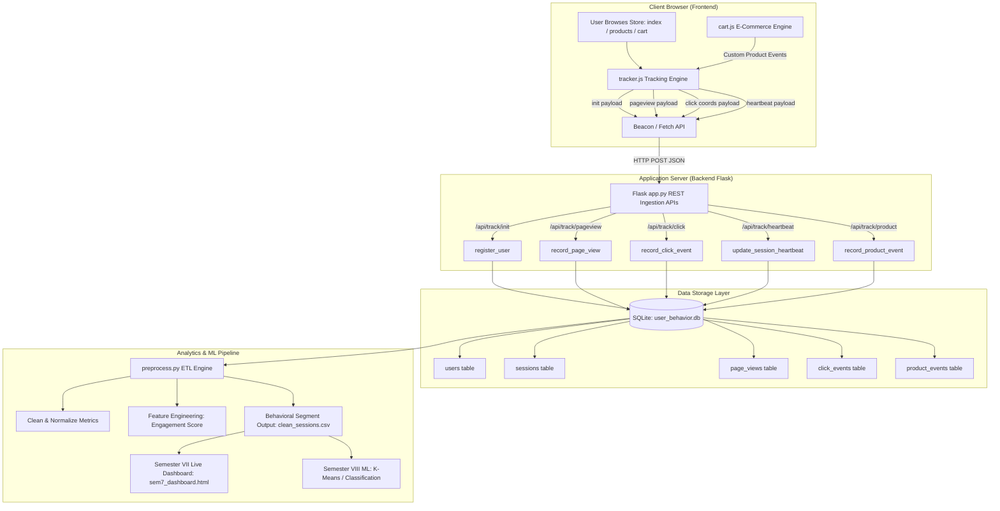

# WEB USER BEHAVIOUR ANALYSIS USING MACHINE LEARNING
## Complete Comprehensive Project Architecture, Implementation Guide & Semester Documentation

> **Academic Session:** 2026–2027  
> **Degree Program:** Bachelor of Technology (B.Tech) in Computer Science and Engineering  
> **Course Semester:** Semester – VII (Minor Project / Progress Review) & Semester – VIII (Final Implementation)  
> **Institution:** ITS Engineering College, Greater Noida – 201306  
> **Affiliated University:** Dr. A.P.J. Abdul Kalam Technical University (AKTU), Lucknow  
> **Project Supervisor:** Mr. Manik Chandra Panday  

---

### Project Team Members & Credentials
| S.No. | Student Name | University Roll Number | Primary Project Role |
| :---: | :--- | :---: | :--- |
| 1 | **Abhineet Kr Sinha** | `2302220100009` | Machine Learning Architecture & Backend APIs |
| 2 | **Viswajeet Kr Singh** | `2302220100010` | Database Design, Pipeline & Data Engineering |
| 3 | **Sanjeet Kumar** | `2302220100163` | Client-Side Tracking Engine & Frontend Integration |
| 4 | **Amrit Raj** | `2302220100032` | Analytics Dashboard, Visualization & Testing |

---

## Table of Contents
1. [Executive Summary & Abstract](#1-executive-summary--abstract)
2. [Project Motivation, Problem Statement & Research Gap](#2-project-motivation-problem-statement--research-gap)
3. [End-to-End System Architecture & Functional Flow](#3-end-to-end-system-architecture--functional-flow)
4. [Detailed Script Architecture & Placement Guide ("Kahan Par Kaunsa Script Lagaye")](#4-detailed-script-architecture--placement-guide)
5. [Machine Learning (ML) Engine Deep-Dive ("ML Kya Hai Aur Kya Nahi Hai")](#5-machine-learning-ml-engine-deep-dive)
6. [Semester VII Progress Integration (Alignment with final2.pdf & PPTX)](#6-semester-vii-progress-integration)
7. [Activity Chart: Semester VII vs. Semester VIII](#7-activity-chart-semester-vii-vs-semester-viii)
8. [Blueprint & Template for Generating Monthly Progress Reports](#8-blueprint--template-for-generating-monthly-progress-reports)
9. [Local Execution, Testing & Data Seeding Guide](#9-local-execution-testing--data-seeding-guide)
10. [Viva Voce & Technical Defense Q&A](#10-viva-voce--technical-defense-qa)
11. [Academic References](#11-academic-references)

---

## 1. Executive Summary & Abstract

The rapid expansion of web applications across e-commerce, education, and digital services has made user interaction data one of the most critical assets for organizational decision-making. Every digital interaction—page views, dwell durations, mouse clicks, coordinate trajectories, scrolling depth, and shopping cart operations—contains latent signals reflecting user intent, engagement, and friction.

Traditional web analytics tools (e.g., standard Google Analytics or basic access log parsers) typically yield aggregate vanity metrics such as total page views and visitor counts. These metrics fail to explain *why* visitors abandon a workflow, *how* users navigate through various product categories, or *what* behavioral patterns distinguish high-intent purchasers from casual window shoppers. Furthermore, enterprise analytics solutions are expensive, proprietary, and difficult for academic institutions and small-to-medium enterprises (SMEs) to customize.

**Web User Behaviour Analysis (WUBA)** is an integrated, end-to-end, open-source web analytics and machine learning platform. It captures granular client-side interaction events in real time, ingests them via a lightweight Python Flask REST API, persists them in a structured relational database (SQLite/MySQL), performs automated preprocessing and feature engineering using Pandas and NumPy, and visualizes behavioral patterns through real-time interactive dashboards. The system lays the foundation for advanced machine learning models (unsupervised clustering, purchase prediction, and navigation path forecasting) to support data-driven website optimization.

```
┌────────────────────────────────────────────────────────────────────────┐
│                        CORE SYSTEM CAPABILITIES                        │
├────────────────────────────────────────────────────────────────────────┤
│ • Automated, non-intrusive client-side tracking (tracker.js)           │
│ • Session lifecycle management with 30-min sliding inactivity expiry   │
│ • Mouse clickstream tracking with exact (X, Y) page coordinates        │
│ • Continuous scroll depth calculation (0% to 100%)                     │
│ • Asynchronous keepalive beacons on tab switch / window unload         │
│ • E-commerce product journey tracking (view, cart add, buy now)        │
│ • Automated behavioral feature engineering (duration, clicks, dwell)   │
│ • Composite Engagement Index (0–100 score per session)                 │
│ • Real-time administration monitor & Semester VII progress dashboard   │
└────────────────────────────────────────────────────────────────────────┘
```

---

## 2. Project Motivation, Problem Statement & Research Gap

### 2.1 Problem Statement
Modern web systems generate substantial volumes of clickstream and telemetry data, yet organizations struggle to convert raw logs into actionable behavioral insights. Existing tools either provide high-level traffic summaries without behavioral depth or represent theoretical research papers that lack deployable, interactive implementations.

### 2.2 Research Gap Analysis
As documented in the project synopsis (`final2.pdf`), the existing landscape contains four primary gaps:

| Approach | Strengths | Limitations / Gaps | WUBA Proposed Improvement |
| :--- | :--- | :--- | :--- |
| **Traditional Web Analytics (Access Logs)** | Simple, built into web servers (Apache, Nginx). | Only records HTTP GET/POST; cannot detect client-side clicks, scroll depth, or client dwell time. | Employs client-side DOM listeners for granular interaction capture. |
| **Commercial Analytics (Google Analytics)** | Highly polished, scalable, feature-rich. | Black-box algorithms, strict data quotas, recurring costs, lack of raw feature access for custom ML. | Fully open-source, zero license cost, direct raw database access for scikit-learn models. |
| **Academic Web Usage Mining Literature** | Strong theoretical models for clustering and Markov chains (Srivastava et al. 2000). | Almost purely conceptual; lacks real-time dashboards, modern responsive frontend, and deployment pipelines. | Bridges theory and practice with a working Flask backend, interactive frontend, and live monitoring dashboard. |

### 2.3 UN Sustainable Development Goals (SDG) Alignment
The project directly aligns with two United Nations Sustainable Development Goals:
- **SDG 9: Industry, Innovation, and Infrastructure:** Fosters inclusive digital innovation by providing an open-source, low-footprint web telemetry and analytics infrastructure suitable for small businesses, startups, and academic institutions.
- **SDG 8: Decent Work and Economic Growth:** Enhances organizational productivity and digital service efficiency by uncovering friction points in digital workflows, improving user retention, and training undergraduate engineers in modern full-stack data science.

---

## 3. End-to-End System Architecture & Functional Flow

The system follows a decoupled three-tier architecture: **Presentation Tier (Frontend)**, **Application/Ingestion Tier (Backend Flask)**, and **Data & Machine Learning Tier (Database, Pandas, Scikit-learn)**.



### Detailed Functional Walkthrough
1. **Visitor Arrival:** A user navigates to `http://localhost:5000/`.
2. **Identification & Fingerprinting:** `tracker.js` executes immediately. It retrieves or generates a persistent `visitor_id` stored in the browser's `localStorage` and a transient `session_id` in `sessionStorage`. It extracts client metadata (Device Type, OS, Browser Name, Screen Resolution) and dispatches an initialization request to `/api/track/init`.
3. **Session Lifecycle:** The server registers or updates the visitor profile in the `users` table and creates/maintains an active session in the `sessions` table.
4. **Active Page Monitoring:**
   - **Page View Logging:** Dispatched to `/api/track/pageview` with page URL, document title, and referrer.
   - **Heartbeat Daemon:** A background JavaScript timer sends a heartbeat ping to `/api/track/heartbeat` every 10 seconds, incrementing the session's cumulative duration in the database.
   - **Scroll Depth Tracking:** A throttled scroll listener calculates `(scrollTop / (scrollHeight - clientHeight)) * 100` and tracks the maximum scroll percentage reached.
   - **Clickstream Telemetry:** Clicks on links, buttons, and product cards capture element ID, tag, CSS class name, inner text (truncated to 50 chars), and exact `(x, y)` mouse coordinates relative to the page.
   - **E-Commerce Actions:** When a user clicks "Add to Cart" or "Buy Now", `cart.js` updates `localStorage` and triggers a product event via `tracker.trackProduct(...)` to `/api/track/product`.
5. **Page Unload / Tab Switch:** When the user closes the tab or switches windows, a `visibilitychange` or `beforeunload` listener triggers `navigator.sendBeacon` with `{keepalive: true}`, recording the final dwell time and scroll depth without delaying navigation.
6. **Data ETL & Feature Transformation:** The Flask backend provides `/api/metrics/processed`. When triggered, `preprocess.py` extracts raw SQL rows into Pandas DataFrames, resolves missing values, derives interaction rates, computes the composite engagement index, and outputs clean behavioral records.
7. **Visualization:** The administrator monitors the system via `http://localhost:5000/dashboard` (`sem7_dashboard.html`). Real-time JavaScript (`dashboard.js`) queries the backend every 8 seconds, updating KPIs, Chart.js graphs, and the live activity stream.

---

## 4. Detailed Script Architecture & Placement Guide

This section explains **where each script is located**, **where it is included in the HTML**, and **how it operates**.

### 4.1 Script Summary & Placement Matrix

| Script Name | Physical File Location | Where It Is Attached / Linked | Execution Role |
| :--- | :--- | :--- | :--- |
| `tracker.js` | `frontend/public/js/tracker.js` | `<script src="/public/js/tracker.js"></script>` at the bottom of **all frontend HTML pages** before `</body>`. | Client-side tracking engine. Manages visitor ID, session lifecycle, clicks, dwell time, scroll depth, and beacon dispatches. |
| `cart.js` | `frontend/public/js/cart.js` | `<script src="/public/js/cart.js"></script>` on store pages: `index.html`, `products.html`, `product-details.html`, `cart.html`, `checkout.html`. | E-commerce shopping cart engine. Manages cart state in `localStorage`, updates badge counts, handles buy-now flows, and emits product telemetry. |
| `dashboard.js` | `frontend/public/js/dashboard.js` | `<script src="/public/js/dashboard.js"></script>` at the bottom of `frontend/sem7_dashboard.html`. | Dashboard polling and charting engine. Fetches `/api/metrics/*`, updates KPI cards, renders Chart.js charts, and updates the table. |
| `style.css` | `frontend/public/css/style.css` | `<link rel="stylesheet" href="/public/css/style.css">` inside `<head>` of all store pages. | Main design system. Google Fonts (Inter + Space Grotesk), dark/light design tokens, glassmorphism navbar, card styles, and toast notifications. |
| `app.py` | `backend/app.py` | Executed directly via Python: `python backend/app.py`. | Flask REST API server. Handles routing for HTML pages, static assets, tracking ingestion APIs, and metrics endpoints. |
| `database.py` | `backend/database.py` | Imported by `app.py` (`import database`). | Database abstraction layer. SQLite initialization, table creation, parameterized inserts, and analytical aggregation queries. |
| `preprocess.py` | `backend/preprocess.py` | Imported by `app.py` (`import preprocess`) and runnable via CLI (`python backend/preprocess.py`). | Pandas/NumPy ETL pipeline. Cleans raw tables, computes derived metrics, calculates composite engagement score, and exports CSV. |
| `seed_data.py` | `backend/seed_data.py` | Imported by `app.py` (`/api/admin/seed`) or executed via CLI: `python backend/seed_data.py`. | Synthetic data generator. Simulates realistic multi-page user journeys, dwell times, and click events for evaluation and testing. |
| `run.py` | `run.py` (Project Root) | Executed by the user: `python run.py`. | Master project launcher. Validates dependencies, checks database, and boots the Flask application server. |

---

### 4.2 Deep Dive: Client-Side Tracker (`frontend/public/js/tracker.js`)

#### 1. Identity & Session Lifecycle
```javascript
// Visitor ID: Stored in localStorage (persistent across browser restarts)
function getVisitorId() {
    let vid = localStorage.getItem('wuba_visitor_id');
    if (!vid) {
        vid = 'vis_' + generateUUID();
        localStorage.setItem('wuba_visitor_id', vid);
    }
    return vid;
}

// Session ID: Stored in sessionStorage with 30-minute inactivity timeout
function getSessionId() {
    const now = Date.now();
    let sid = sessionStorage.getItem('wuba_session_id');
    let lastActivity = parseInt(sessionStorage.getItem('wuba_last_activity') || '0', 10);

    if (!sid || (now - lastActivity > 30 * 60 * 1000)) {
        sid = 'sess_' + generateUUID();
        sessionStorage.setItem('wuba_session_id', sid);
        sessionStorage.setItem('wuba_session_start', now.toString());
    }
    sessionStorage.setItem('wuba_last_activity', now.toString());
    return sid;
}
```

#### 2. Non-Blocking Ingestion via Beacon & Keepalive Fetch
To ensure analytics payloads are delivered reliably even when a user closes a tab or navigates to an external site, `tracker.js` uses `navigator.sendBeacon` for unload events and `fetch` with `keepalive: true` for interactive events:
```javascript
function sendPayload(endpoint, payload, useBeacon = false) {
    const url = `/api/track/${endpoint}`;
    const dataStr = JSON.stringify(payload);

    if (useBeacon && navigator.sendBeacon) {
        const blob = new Blob([dataStr], { type: 'application/json' });
        navigator.sendBeacon(url, blob);
    } else {
        fetch(url, {
            method: 'POST',
            headers: { 'Content-Type': 'application/json' },
            body: dataStr,
            keepalive: true
        }).catch(err => console.debug('[WUBA Tracker] Network sync note:', err));
    }
}
```

#### 3. Granular Clickstream & Product Capture
`tracker.js` binds to the root document using event capturing (`true`). It extracts target element identifiers, checks if the clicked element belongs to a product card (`data-product-id`), and automatically infers whether the action was an `add_to_cart`, `buy_now`, or detail inspection:
```javascript
document.addEventListener('click', (e) => {
    const target = e.target.closest('a, button, input, [role="button"], .clickable, [data-product-id]') || e.target;
    // Captures element ID, tag, class, text, and (x, y) coordinates
    sendPayload('click', {
        session_id: this.sessionId,
        visitor_id: this.visitorId,
        page_url: this.pageUrl,
        element_id: target.id || '',
        element_tag: target.tagName || '',
        element_class: target.className || '',
        element_text: (target.innerText || '').trim().substring(0, 50),
        x_pos: Math.round(e.pageX),
        y_pos: Math.round(e.pageY)
    });
}, true);
```

---

### 4.3 Deep Dive: Database Schema (`backend/database.py`)

The relational schema is implemented in SQLite (easily upgradeable to MySQL or PostgreSQL) with five normalized tables:

```sql
-- 1. Visitors / Device Fingerprints
CREATE TABLE IF NOT EXISTS users (
    visitor_id TEXT PRIMARY KEY,
    first_seen TIMESTAMP DEFAULT CURRENT_TIMESTAMP,
    last_seen TIMESTAMP DEFAULT CURRENT_TIMESTAMP,
    device_type TEXT,
    browser TEXT,
    os TEXT,
    screen_resolution TEXT
);

-- 2. User Browsing Sessions
CREATE TABLE IF NOT EXISTS sessions (
    session_id TEXT PRIMARY KEY,
    visitor_id TEXT,
    start_time TIMESTAMP DEFAULT CURRENT_TIMESTAMP,
    end_time TIMESTAMP,
    duration_seconds REAL DEFAULT 0,
    page_views_count INTEGER DEFAULT 1,
    click_count INTEGER DEFAULT 0,
    is_bounce INTEGER DEFAULT 1,
    entry_page TEXT,
    exit_page TEXT,
    FOREIGN KEY (visitor_id) REFERENCES users (visitor_id)
);

-- 3. Page Visits & Dwell Durations
CREATE TABLE IF NOT EXISTS page_views (
    id INTEGER PRIMARY KEY AUTOINCREMENT,
    session_id TEXT,
    visitor_id TEXT,
    page_url TEXT,
    page_title TEXT,
    referrer TEXT,
    timestamp TIMESTAMP DEFAULT CURRENT_TIMESTAMP,
    dwell_time_seconds REAL DEFAULT 0,
    scroll_depth_percent REAL DEFAULT 0,
    FOREIGN KEY (session_id) REFERENCES sessions (session_id),
    FOREIGN KEY (visitor_id) REFERENCES users (visitor_id)
);

-- 4. Interactive Clickstream Events
CREATE TABLE IF NOT EXISTS click_events (
    id INTEGER PRIMARY KEY AUTOINCREMENT,
    session_id TEXT,
    visitor_id TEXT,
    page_url TEXT,
    element_id TEXT,
    element_tag TEXT,
    element_class TEXT,
    element_text TEXT,
    x_pos REAL,
    y_pos REAL,
    timestamp TIMESTAMP DEFAULT CURRENT_TIMESTAMP,
    FOREIGN KEY (session_id) REFERENCES sessions (session_id),
    FOREIGN KEY (visitor_id) REFERENCES users (visitor_id)
);

-- 5. Per-Product Telemetry & Conversion Events
CREATE TABLE IF NOT EXISTS product_events (
    id INTEGER PRIMARY KEY AUTOINCREMENT,
    session_id TEXT,
    visitor_id TEXT,
    product_id TEXT,
    product_name TEXT,
    category TEXT,
    price REAL DEFAULT 0,
    event_type TEXT, -- 'view', 'add_to_cart', 'buy_now', 'click_details'
    dwell_time_seconds REAL DEFAULT 0,
    timestamp TIMESTAMP DEFAULT CURRENT_TIMESTAMP,
    FOREIGN KEY (session_id) REFERENCES sessions (session_id),
    FOREIGN KEY (visitor_id) REFERENCES users (visitor_id)
);
```

---

## 5. Machine Learning (ML) Engine Deep-Dive

### 5.1 What ML Is vs. What It Is Not in This Project

> [!IMPORTANT]
> **Clarification for Viva & Project Review:**
> - **What is NOT ML:** Calculating simple averages (average dwell time, total visitors, bounce percentage) or counting database records is standard SQL aggregation and descriptive analytics, **not** Machine Learning.
> - **What IS ML:** Machine Learning in this project refers to **discovering hidden behavioral structures from high-dimensional interaction features** (Unsupervised Learning) and **predicting visitor actions/intent before they happen** (Supervised Learning and Sequential Modeling).

---

### 5.2 Current State: Semester VII Feature Engineering Pipeline (`preprocess.py`)
In Semester VII, the data preparation and feature engineering pipeline was implemented using **Pandas** and **NumPy**. Raw database records are cleaned, transformed, and combined into feature vectors:

#### Derived Feature Matrix
1. **Duration in Minutes:** $\text{duration\_minutes} = \frac{\text{duration\_seconds}}{60.0}$
2. **Click Intensity (Interaction Rate):**
   $$\text{clicks\_per\_page} = \begin{cases} \frac{\text{click\_count}}{\text{page\_views\_count}} & \text{if } \text{page\_views\_count} > 0 \\ 0 & \text{otherwise} \end{cases}$$
3. **Average Dwell Time per Page:**
   $$\text{avg\_dwell\_per\_page} = \frac{\text{duration\_seconds}}{\text{page\_views\_count}}$$
4. **Session Scroll Depth:** Mean scroll depth across all visited pages in the session.
5. **Normalized Composite Engagement Score (Formula):**
   To produce a standardized benchmark between 0 and 100 for every user session, four behavioral signals are normalized and weighted:
   $$\text{Dur}_{\text{norm}} = \min\left(1.0, \frac{\text{duration\_seconds}}{300}\right) \quad (\text{Capped at 5 mins})$$
   $$\text{PV}_{\text{norm}} = \min\left(1.0, \frac{\text{page\_views\_count}}{10}\right) \quad (\text{Capped at 10 pages})$$
   $$\text{Click}_{\text{norm}} = \min\left(1.0, \frac{\text{click\_count}}{20}\right) \quad (\text{Capped at 20 clicks})$$
   $$\text{Scroll}_{\text{norm}} = \frac{\text{avg\_scroll\_depth}}{100.0}$$

   $$\text{Engagement Score} = \left(0.30 \cdot \text{Dur}_{\text{norm}} + 0.30 \cdot \text{PV}_{\text{norm}} + 0.20 \cdot \text{Click}_{\text{norm}} + 0.20 \cdot \text{Scroll}_{\text{norm}}\right) \times 100$$

6. **Behavioral Segmentation Classes:**
   - **Score $\ge 70$:** `High Engagement (Power User)`
   - **$35 \le$ Score $< 70$:** `Moderate Engagement (Explorer)`
   - **Score $< 35$:** `Low Engagement (Bouncer / Casual)`

Output file: `backend/data/processed/clean_sessions.csv`.

---

### 5.3 Semester VIII Target: Planned Machine Learning Algorithms

In Semester VIII, the clean datasets generated during Semester VII will be fed into three machine learning pipelines built with **Scikit-learn**:

```
                       CLEAN SESSIONS DATASET
                     (clean_sessions.csv / SQL)
                                 │
         ┌───────────────────────┼───────────────────────┐
         ▼                       ▼                       ▼
 1. UNSUPERVISED         2. SUPERVISED           3. SEQUENTIAL
    CLUSTERING              CLASSIFICATION          MODELING
 (K-Means & DBSCAN)    (Random Forest/XGBoost)   (Markov Chains)
         │                       │                       │
 • Elbow / Silhouette    • Purchase Intent (0/1) • Next-page recommendation
 • Discovers Visitor     • Bounce Risk (0/1)     • Transition Probability
   Personas & Archetypes • Accuracy / F1-Score     Matrix P(S_t+1 | S_t)
```

#### 1. Unsupervised User Clustering (K-Means & DBSCAN)
- **Objective:** Group visitors into unlabelled behavioral clusters without human bias.
- **Input Feature Vector:** $X = [\text{duration\_seconds}, \text{page\_views\_count}, \text{click\_count}, \text{avg\_scroll\_depth}, \text{clicks\_per\_page}, \text{avg\_dwell\_per\_page}]$.
- **Data Preprocessing:** Standard scaling via `StandardScaler()`:
  $$z = \frac{x - \mu}{\sigma}$$
- **Optimal Cluster Selection ($k$):**
  - **Elbow Method:** Minimizing Within-Cluster Sum of Squares (Inertia):
    $$\text{WCSS} = \sum_{i=1}^{k} \sum_{x \in C_i} ||x - \mu_i||^2$$
  - **Silhouette Coefficient Analysis:**
    $$s(i) = \frac{b(i) - a(i)}{\max(a(i), b(i))}$$
    Where $a(i)$ is the mean intra-cluster distance, and $b(i)$ is the mean nearest-cluster distance. A silhouette score approaching $+1$ confirms distinct, well-separated clusters.
- **Expected Behavioral Personas:**
  1. *Cluster 0 (Window Shoppers):* High page views, low dwell time per page, 0 cart adds.
  2. *Cluster 1 (Targeted Buyers):* Low page views, direct search/product visit, high click intensity, fast checkout.
  3. *Cluster 2 (In-Depth Researchers):* Long dwell time, high scroll depth (80%+), multiple product detail visits.
  4. *Cluster 3 (Disoriented Visitors):* High clicks, erratic page transitions, high dwell without progress (indicates navigation friction).

#### 2. Supervised Purchase Intent Classification (Random Forest & Logistic Regression)
- **Objective:** Predict in real time whether an ongoing user session will culminate in a conversion (`add_to_cart` or `buy_now`).
- **Binary Target:** $Y \in \{0, 1\}$ (0 = No Purchase Intent, 1 = Purchase Intent).
- **Candidate Models:**
  - **Baseline:** Logistic Regression with L2 regularization.
  - **Ensemble Model:** Random Forest Classifier (100 estimators, Gini impurity criterion).
- **Evaluation Metrics (As specified in final2.pdf synopsis):**
  - **Accuracy:** $\frac{TP + TN}{TP + TN + FP + FN}$
  - **Precision:** $\frac{TP}{TP + FP}$ (Minimizing false promotional triggers)
  - **Recall (Sensitivity):** $\frac{TP}{TP + FN}$ (Capturing as many prospective buyers as possible)
  - **F1-Score:** $2 \times \frac{\text{Precision} \times \text{Recall}}{\text{Precision} + \text{Recall}}$
  - **ROC-AUC:** Area under the Receiver Operating Characteristic curve.

#### 3. Sequential Path & Navigation Prediction (First-Order Markov Chain)
- **Objective:** Model the probability of a user transitioning from page $S_i$ to page $S_j$.
- **Formulation:**
  $$P(S_{t+1} = j \mid S_t = i) = \frac{N(i \to j)}{\sum_{k} N(i \to k)}$$
  Where $N(i \to j)$ represents the observed count of user transitions from page $i$ to page $j$.
- **Application:** Powering personalized navigation shortcuts and predicting checkout drop-offs before the user exits.

#### 4. Regression Analysis for Dwell Duration Estimation
- **Objective:** Predict total session dwell time based on initial landing characteristics.
- **Evaluation Metric:** Mean Squared Error (MSE) and Root Mean Squared Error (RMSE):
  $$\text{MSE} = \frac{1}{n} \sum_{i=1}^{n} (y_i - \hat{y}_i)^2$$

---

## 6. Semester VII Progress Integration

### 6.1 Alignment with Project Synopsis (`final2.pdf`) & Presentation (`.pptx`)
Under the academic framework of Dr. A.P.J. Abdul Kalam Technical University (AKTU) for the B.Tech CSE Final Year Project, the project is structured across two distinct semesters:
- **Semester VII (Current):** Project Conception, Literature Review, Requirement Analysis, Architecture Design, Database Implementation, Full Client-Side Tracking Engine, Ingestion Backend, Data Preprocessing Pipeline, and Live Monitoring Progress Dashboard.
- **Semester VIII (Upcoming):** Machine Learning Model Training, Hyperparameter Optimization, Streamlit Graphical Visualizations (Plotly, Matplotlib, Seaborn), Cloud Deployment, and Final Thesis/Viva Voce.

### 6.2 Phase-Wise Methodology Breakdown

```
Phase 1: Requirements Analysis ──► [COMPLETED - Sem VII]
Phase 2: System & DB Design    ──► [COMPLETED - Sem VII]
Phase 3: Frontend & Backend    ──► [COMPLETED - Sem VII]
Phase 4: Data Processing & ML  ──► [Data Pipeline COMPLETED - Sem VII | ML Training in Sem VIII]
Phase 5: Dashboard & Testing   ──► [Web Monitor COMPLETED - Sem VII | Streamlit Visuals in Sem VIII]
Phase 6: Cloud Deployment      ──► [SCHEDULED - Sem VIII (Render / Heroku)]
```

- **Phase 1 – Requirement Analysis:** Formulated problem statement, surveyed foundational literature (Web Usage Mining by Srivastava et al. 2000, Mobasher et al. 2000), defined tracking metrics (dwell, bounce, clickstream).
- **Phase 2 – System Design:** Architected decoupled frontend-backend model; drafted SQLite relational schema covering `users`, `sessions`, `page_views`, `click_events`, and `product_events`.
- **Phase 3 – Development:** Implemented responsive frontend (HTML5, CSS3, JavaScript, Bootstrap 5) and Python Flask backend server (`app.py`) with REST ingestion endpoints (`/api/track/*`).
- **Phase 4 – Data Processing & Feature Engineering:** Developed `preprocess.py` using Pandas and NumPy to clean raw logs, calculate derived rates, compute the 0–100 composite engagement score, and generate `clean_sessions.csv`.
- **Phase 5 – Dashboard & Testing:** Built `sem7_dashboard.html` with real-time KPI monitors, Chart.js visualizations, and an automated data seeding simulator (`seed_data.py`).
- **Phase 6 – Deployment & Finalization:** Scheduled for Semester VIII (deploying on cloud PaaS such as Render or Heroku, with Streamlit analytics).

---

## 7. Activity Chart: Semester VII vs. Semester VIII

This table mirrors **Table 3 of the official synopsis document (`final2.pdf`)** and serves as the baseline for university evaluation:

| Activity / Work Package | Semester VII (Progress) | Semester VIII (Target) | Status & Evidence |
| :--- | :---: | :---: | :--- |
| **Project Topic Selection** | :white_check_mark: Completed | Completed | Approved by Department & Guide |
| **Literature Survey** | :white_check_mark: Completed | Completed | Documented in Synopsis & Chapter 2 |
| **Requirement Analysis** | :white_check_mark: Completed | Completed | Functional & Non-Functional Specs Defined |
| **System & Architecture Design** | :white_check_mark: Completed | Completed | Three-Tier Architecture & Pipeline Designed |
| **Database Design & Implementation** | :white_check_mark: Completed | Scale / Indexing | 5 Normalized Tables in `user_behavior.db` |
| **Frontend Development** | :white_check_mark: Completed | UI Polish | Store, Products, Cart, Checkout, Blog Pages |
| **Backend Development** | :white_check_mark: Completed | ML Inference APIs | Flask REST Server (`app.py`) Operational |
| **Client-Side Tracking Engine** | :white_check_mark: Completed | Enhanced Beacons | `tracker.js` Capturing Clicks, Dwell, Scroll |
| **Data Preprocessing & Feature Engineering** | :white_check_mark: Completed | Automated ETL | `preprocess.py` (Pandas/NumPy) Operational |
| **Machine Learning Model Development** | *Foundations Prepared* | :hourglass_flowing_sand: **Primary Target** | K-Means, DBSCAN, Random Forest, Markov |
| **Streamlit Interactive Visualizations** | *Web Monitor Built* | :hourglass_flowing_sand: **Primary Target** | Matplotlib, Seaborn, Plotly Dashboards |
| **Testing & Bug Fixing** | :white_check_mark: Unit/Integration Done | Stress Testing | Synthetic Seeder & Flow Verification |
| **Cloud Deployment** | Local Server Ready | :hourglass_flowing_sand: **Primary Target** | Deployment on Render / Heroku PaaS |
| **Documentation & Progress Report** | :white_check_mark: Completed | Final Project Thesis | `1.md` and Progress Reports Generated |
| **Project Presentation & Viva Voce** | :white_check_mark: Sem VII Defense | Final B.Tech Viva | Slides & Defense Materials Prepared |

---

## 8. Blueprint & Template for Generating Monthly Progress Reports

Use the templates below to submit periodic progress reports to your project coordinator or supervisor.

### 8.1 Monthly Progress Tracking Matrix

```
MONTH 1: Topic Finalization, Literature Review, Problem Formulation & Synopsis Submission
MONTH 2: Architectural Specification, Decoupled Frontend/Backend Setup, Database Schema Creation
MONTH 3: Client Tracking Script (tracker.js), Event Listeners, Flask Ingestion REST APIs
MONTH 4: E-Commerce Store Integration, Product Telemetry, Data Preprocessing Pipeline (Pandas/NumPy)
MONTH 5: Semester VII Evaluation Dashboard, Data Seeding Engine, Progress Report & Sem VII Viva
MONTH 6 (Sem VIII): Machine Learning Training (K-Means, Random Forest), Streamlit Visualization
MONTH 7 (Sem VIII): Cloud Deployment (Render/Heroku), Final Thesis Compilation, Final Degree Viva
```

---

### 8.2 Standard Monthly Report Template Format

```markdown
# MONTHLY PROJECT PROGRESS REPORT - MONTH [X]
**Project Title:** Web User Behaviour Analysis Using Machine Learning
**Supervisor:** Mr. Manik Chandra Panday
**Team:** Abhineet Kr Sinha, Viswajeet Kr Singh, Sanjeet Kumar, Amrit Raj
**Period:** [Start Date] to [End Date]

### 1. Objectives Planned for the Month
- [ ] Task A: ...
- [ ] Task B: ...

### 2. Work Accomplished During the Month
- **Frontend / Tracking:** Detailed description of code changes...
- **Backend / APIs:** Endpoints developed or tested...
- **Data Engineering / ML:** Preprocessing routines or models evaluated...

### 3. Key Technical Artifacts Generated
- Files Modified: `...`
- Commits / Test Results: `...`

### 4. Challenges Encountered & Resolutions
- *Challenge:* ...
- *Resolution:* ...

### 5. Plan for Next Month
- Objective 1: ...
- Objective 2: ...

**Supervisor Signature:** ____________________     **Date:** _______________
```

---

### 8.3 University B.Tech Final Project Report Structure (AKTU Standard)
When compiling the complete final thesis in Semester VIII, structure the chapters as follows:
- **Title Page & Certificates:** Certificate of Originality, College Approval, Supervisor Recommendation.
- **Acknowledgements & Abstract:** Executive summary and keywords.
- **Chapter 1: Introduction:** Background, Motivation, Problem Statement, Objectives, Scope, UN SDG Alignment.
- **Chapter 2: Literature Survey:** Web Usage Mining history, comparative analysis of existing tools, research gap.
- **Chapter 3: System Requirements & Architecture:** Hardware/software specs, three-tier architecture diagram, database schema.
- **Chapter 4: Implementation Details:** Client-side tracking (`tracker.js`), backend ingestion (`app.py`), database layer (`database.py`), data preprocessing (`preprocess.py`).
- **Chapter 5: Machine Learning & Behavioral Modeling:** Feature engineering, K-Means clustering, Random Forest classification, Markov navigation modeling, evaluation metrics (Accuracy, F1-Score, MSE).
- **Chapter 6: Results, Visualization & Discussion:** Dashboard screenshots, confusion matrices, elbow curves, insight interpretations.
- **Chapter 7: Conclusion & Future Scope:** Summary of achievements, limitations, mobile app extension, real-time personalization.
- **References:** IEEE format bibliography.

---

## 9. Local Execution, Testing & Data Seeding Guide

### 9.1 Prerequisites & Installation
Ensure Python 3.9+ is installed on the system.

1. **Clone the repository:**
   ```bash
   git clone https://github.com/your-username/Web-User-Behavior-Analysis.git
   cd "Web User Behavior Analysis"
   ```

2. **Install Python Dependencies:**
   ```bash
   pip install -r requirements.txt
   ```
   *Required packages:* `flask`, `pandas`, `numpy`, `scikit-learn`, `matplotlib`, `seaborn`, `plotly`, `streamlit`.

3. **Initialize the Database:**
   The SQLite database (`backend/data/user_behavior.db`) is automatically created on startup by `database.init_db()`.

---

### 9.2 Running the Application Server
You can launch the project using either of the following commands:

- **Option A (Master Launcher):**
  ```bash
  python run.py
  ```
- **Option B (Direct Flask Server):**
  ```bash
  python backend/app.py
  ```

Once started, the server outputs:
```
============================================================
Web User Behaviour Analysis - Flask Backend Server
Semester VII Progress Implementation
Serving on http://localhost:5000
Semester VII Live Dashboard: http://localhost:5000/dashboard
============================================================
```

---

### 9.3 Accessing Project Interfaces

| Interface | URL | Description |
| :--- | :--- | :--- |
| **Home Page (Storefront)** | `http://localhost:5000/` | Main landing page with tracked hero actions, categories, and featured products. |
| **Product Catalog** | `http://localhost:5000/products.html` | 15 products with filters, sorting, search, "Add to Cart", and "Buy Now" triggers. |
| **Shopping Cart** | `http://localhost:5000/cart.html` | Real-time cart viewer with quantity management and order summary. |
| **Checkout Workflow** | `http://localhost:5000/checkout.html` | Multi-step form tracking checkout initiation and conversion completion. |
| **Semester VII Progress Dashboard** | `http://localhost:5000/dashboard` | Administrator monitoring dashboard showing live metrics, charts, and preprocessed sessions. |

---

### 9.4 Testing & Seeding Synthetic Data
To demonstrate the platform to evaluators with realistic multi-user data:

1. **Via Dashboard Button:**
   - Navigate to `http://localhost:5000/dashboard`.
   - Click the green **"⚡ Seed 20 Visitor Journeys"** button in the header.
   - The system generates 20 realistic visitor journeys with realistic dwell times, scrolls, and clicks.
2. **Via Command Line:**
   ```bash
   python backend/seed_data.py
   ```
3. **Verify Preprocessed Feature Matrix:**
   ```bash
   python backend/preprocess.py
   ```
   This generates `backend/data/processed/clean_sessions.csv` containing derived engagement scores and behavioral segments.

---

## 10. Viva Voce & Technical Defense Q&A

This section provides answers to common technical questions asked by university examiners during project defense:

#### Q1: What is the fundamental difference between a Visitor and a Session in your system?
**Answer:** A **Visitor** represents an individual client device or browser profile, uniquely identified by a persistent UUID stored in `localStorage` (`visitor_id`). A **Session** represents a single, continuous browsing interaction period stored in `sessionStorage` (`session_id`). A single visitor can have multiple sessions over time. A session expires after 30 minutes of continuous user inactivity.

#### Q2: Why did you use `navigator.sendBeacon` instead of a standard `fetch` call during page unload?
**Answer:** When a user closes a browser tab or navigates away, standard asynchronous `fetch` or `XMLHttpRequest` calls are often abruptly terminated by the browser engine before completion. `navigator.sendBeacon()` queues the data to be transmitted asynchronously by the browser process itself over HTTP POST, guaranteeing delivery without delaying page unload or degrading user experience.

#### Q3: How do you handle user privacy and consent?
**Answer:** The tracking script is completely first-party, non-intrusive, and cookieless. It does **not** capture personally identifiable information (PII) such as passwords, banking credentials, or personal email addresses. It solely records behavioral telemetry: interaction timestamps, element tags, coordinates, and dwell durations.

#### Q4: What makes your engagement score better than just looking at page views?
**Answer:** A user who opens 10 pages in 10 seconds and leaves (high bounce / bot behavior) would appear "engaged" if only page views were counted. Our Composite Engagement Index combines four independent dimensions: **Duration (30%)**, **Page Views (30%)**, **Click Intensity (20%)**, and **Scroll Depth (20%)**. This ensures that true engagement requires both active dwell time and meaningful physical interaction with the page content.

#### Q5: Why is K-Means clustering appropriate for your behavioral segmentation in Semester VIII?
**Answer:** User interaction data forms continuous numerical feature vectors (dwell time, clicks per page, scroll depth). K-Means operates efficiently ($O(n \cdot k \cdot d)$) on standardized continuous features. By applying the Elbow method and Silhouette score analysis, we can determine the natural number of user clusters (e.g., Casual Window Shoppers vs. Direct Buyers) without needing pre-existing manual labels.

#### Q6: How does the system prevent database locking during high-concurrency click logging?
**Answer:** In the current prototype, SQLite operates with WAL (Write-Ahead Logging) enabled and parameterized short transactions. For production enterprise deployments in Semester VIII, the database layer is written using standard SQL abstractions, allowing seamless migration to PostgreSQL or MySQL with connection pooling.

---

## 11. Academic References

1. **J. Srivastava, R. Cooley, M. Deshpande, and P.-N. Tan**, *"Web usage mining: Discovery and applications of usage patterns from web data,"* SIGKDD Explorations, vol. 1, no. 2, pp. 12–23, 2000.
2. **B. Mobasher, R. Cooley, and J. Srivastava**, *"Automatic personalization based on web usage mining,"* Communications of the ACM, vol. 43, no. 8, pp. 142–151, 2000.
3. **R. Kosala and H. Blockeel**, *"Web mining research: A survey,"* SIGKDD Explorations, vol. 2, no. 1, pp. 1–15, 2000.
4. **F. Pedregosa et al.**, *"Scikit-learn: Machine learning in Python,"* Journal of Machine Learning Research, vol. 12, pp. 2825–2830, 2011.
5. **W. McKinney**, *"Data structures for statistical computing in Python,"* Proceedings of the 9th Python in Science Conference, pp. 56–61, 2010.
6. **J. D. Hunter**, *"Matplotlib: A 2D graphics environment,"* Computing in Science & Engineering, vol. 9, no. 3, pp. 90–95, 2007.
7. **M. L. Waskom**, *"Seaborn: Statistical data visualization,"* Journal of Open Source Software, vol. 6, no. 60, p. 3021, 2021.
8. **Plotly Technologies Inc.**, *"Collaborative data science,"* Montreal, QC, Canada, 2015. [Online: https://plot.ly]
9. **Pallets Projects**, *"Flask documentation,"* 2024. [Online: https://flask.palletsprojects.com]
10. **Streamlit Inc.**, *"Streamlit documentation,"* 2024. [Online: https://docs.streamlit.io]

---
*Document compiled and verified for Semester VII Minor Project Evaluation & Semester VIII Major Project Implementation.*
